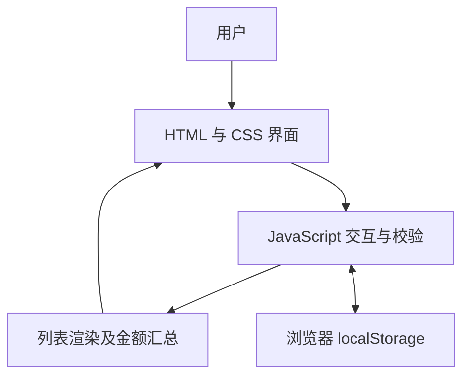

# 轻量商品管理演示 — 项目介绍

“轻量商品管理演示”是一个单文件、零依赖的纯前端商品管理 Web 应用，由华为云 CodeArts 代码智能体辅助生成，用于学习如何构建并验收具备增删改查能力的前端应用。全部样式与脚本内联在 `index.html` 中，无需构建工具或后端服务，用现代浏览器即可打开。

## 功能概览

应用围绕商品管理的基础操作设计：在顶部表单录入名称、数量与单价，校验通过后加入列表；通过行内编辑修改字段；删除前弹出确认；按名称进行实时模糊搜索。数量要求为非负整数，单价要求为非负数且处于合理范围。列表展示每项小计，并计算当前匹配列表的数量及金额合计。

数据通过浏览器 `localStorage` 保存，刷新后可继续查看。应用不包含账号系统，也不在不同浏览器、设备之间同步。

## 系统架构

浏览器是唯一运行环境。表现层由 HTML 与 CSS 负责表单、表格及反馈；逻辑层由 JavaScript 负责校验、搜索、编辑和删除；存储层使用当前浏览器的 localStorage。所有读写在浏览器内完成，应用代码没有后端请求，也没有第三方脚本依赖。这种结构适合教学演示与快速原型验证。

## 技术实现

界面采用蓝色渐变标题栏、卡片式布局、响应式表单与悬停高亮表格。添加、编辑、删除按钮使用不同颜色区分；交互反馈通过 Toast 与表单提示显示。编辑行以背景高亮标识。

脚本采用立即执行函数封装，面向现代浏览器，使用 `Number.isInteger`、`Array.find`、`Element.closest` 等 API。商品名称在拼接 HTML 时经过 `escapeHtml` 转义。此措施不代表项目完成了生产级安全审计。

## 测试与质量

此前 CodeArts 测试报告显示 13/13 通过，覆盖添加、校验拦截、修改、删除、刷新持久化与名称搜索。独立手工确认了添加、修改、刷新保存和删除四项：测试商品数量 2、单价 3.50 时小计为 7.00；数量改为 3 后小计为 10.50；刷新后保留；删除后恢复 3 条演示数据。

## 已知限制

- 删除全部商品后刷新，会重新生成 3 条演示数据。
- 搜索时金额与数量合计只统计当前匹配列表。
- localStorage 不具备数据库、备份与访问控制能力；清理浏览器数据会丢失记录。
- 金额采用浮点数计算，不适用于真实财务结算。
- 示例云产品名称与价格不代表官方报价。

## 定位说明

这是 AI 辅助生成的学习演示作品，非生产系统。应用仅在本地浏览器保存商品数据，不上传商品信息，不调用付费 API，不依赖云资源。适合学习前端基础、体验 CodeArts 开发流程以及练习对 AI 生成结果进行实际验收。
